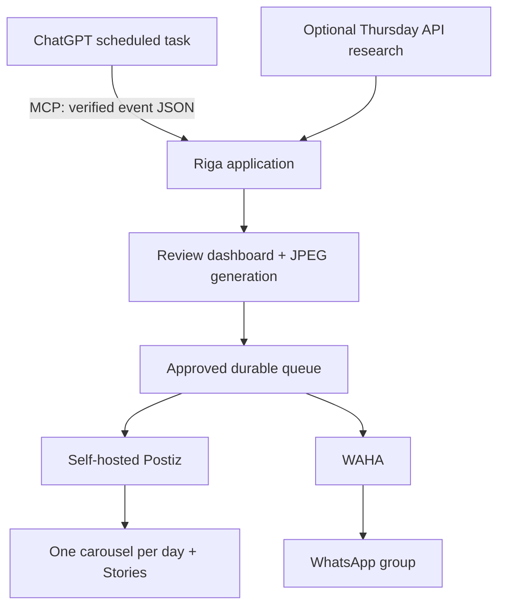

# Rīga Weekend

An isolated Docker stack that turns researched Riga events into Instagram carousels, Stories and a WhatsApp roundup. It supports your existing ChatGPT scheduled task through MCP, or an optional OpenAI API research worker on your VPS.

**Current state:** working application and integration adapters, authenticated review dashboard, persistent delivery ledger with Postiz scheduling and on-demand WhatsApp, Docker deployment and automated tests. Live accounts are not connected. Publishing and paid research are disabled by default. Demo events are fictional and cannot be approved.

## Run with Docker

Docker with Compose is the only host dependency. You do not need Node, npm, Postgres or Redis installed on your machine.

```sh
sh scripts/bootstrap.sh
docker compose build
docker compose up -d app worker
docker compose run --rm app node src/cli.js demo
```

Open http://localhost:3100. Username: `admin`. Password: the generated `ADMIN_TOKEN` in your private `.env`. The setup script never prints secrets and never overwrites an existing `.env`.

Start the complete stack, including WhatsApp:

```sh
docker compose --profile whatsapp up -d
```

Postiz is at http://localhost:4007. WAHA is at http://localhost:3001. Service ports bind only to localhost. Postgres, Redis, Temporal and Elasticsearch have no published host ports.

```sh
# Tests run in a container with no external network, credentials or data volumes.
docker compose --profile test build test
docker compose --profile test run --rm test

# Logs / status / stop (keeps all persistent data)
docker compose ps
docker compose logs --tail=100 app worker
docker compose --profile whatsapp --profile production down
```

Never add `--volumes` to `down` unless you intend to delete databases, uploaded media and WhatsApp sessions.

## Isolation

- Application code and npm dependencies are baked into images. Runtime containers do not mount the project, home directory or Docker socket.
- App and worker run as a non-root user, with read-only root filesystems, dropped capabilities and `no-new-privileges`.
- Persistent data lives in project-scoped Docker named volumes. Temporary files use container tmpfs.
- The only runtime host-file mounts are read-only Caddy and Temporal configuration files.
- The one-shot bootstrap container mounts this project to write `.env`; it has no network access. Secrets stay out of Git and Docker build context.
- The stack uses its own Compose network. The worker needs outbound HTTPS for OpenAI, Postiz providers and WhatsApp. Containers are isolation, not a separate physical machine; Docker Desktop still consumes host RAM and disk.

## What runs



Postiz runs with its own PostgreSQL, Redis and Temporal services. Temporal uses a separate PostgreSQL and Elasticsearch, based on the official Postiz Compose architecture. The application uses SQLite in its own persistent volume. Run exactly **one worker replica**.

Each card uses the organiser's own sharing image (the `og:image` on the event page already cited), cropped to Instagram dimensions under a dark scrim, with the organiser's domain credited on the card. Events may also carry an explicit `imageUrl`. Nothing is ever substituted from elsewhere. An event with no organiser image shows **No photo** on the review page, with an **Add photo** button: your upload (JPEG, PNG or WebP, at least 400 pixels on the shorter side, up to 15 MB) is rotated upright, stripped of all metadata including GPS location, and used on that event's slide and story without a credit line. You can also replace an organiser image with your own, or remove your photo again. When a page offers no usable image, or the fetch fails, the card falls back to the typographic design. Image requests are HTTPS-only, refuse private address ranges and redirects into them, cap size and time, and re-encode through sharp. Organiser links appear in both the WhatsApp digest and the Instagram caption; if the caption would pass 2,200 characters the links shorten to hostnames and then drop, rather than rejecting the edition.

Publishing someone else's promotional image is the organiser's material, not yours. Crediting and linking the organiser is the normal practice for event listings, but it is not a licence: if an organiser objects, set `imageUrl` to your own photo or let the card fall back.

Each event slide leads with the name, then the date and price at equal weight, then the venue smaller, with the language tag in the corner. Each slide carries a large number, counted within its own post, and the caption uses the same numbers: for each event the title, the description (including age limits and door times) and a **short link** to the organiser page. Short links are served by this app itself (`/k7m2x`, public, no login), redirect only to organiser URLs the server stored, count clicks shown on the review page, and keep the same code whenever the same page appears again. They use `SHORT_LINK_BASE` when set to a short domain you own, otherwise the dashboard's own host. With `EJUZ_API_KEY` set (a key from your own ej.uz account), approving also creates an ej.uz link for each published event, and captions print `ej.uz/…` instead; candidate events you leave out never reach ej.uz. If ej.uz refuses a URL (it keeps a domain blocklist), rejects the key, or is unavailable three times in a row, captions fall back to the app's own link, which keeps working regardless. ej.uz links are made only for events that will actually be published: the selection is checked first, links are created, and only then is the edition approved and handed to Postiz, so a refused approval or an unticked event never produces a link. Requests follow the limits ej.uz's developer set (30 a minute, 100 an hour, 500 a day for generated links, which may change); the defaults stay under them via `EJUZ_PER_MINUTE`, `EJUZ_PER_HOUR` and `EJUZ_PER_DAY`, and a run that reaches a limit, or gets a rate-limit answer, stops and falls back to the app's own links. `node src/cli.js links` fills in links only for approved editions. The client follows ej.uz's API documentation (Beta, `https://ej.uz/api/v1`): decisions use HTTP status rather than message text, translated `{en, lv, ja}` messages are handled, a short `Retry-After` on 429 is waited out once, a deleted link (404) is treated as gone, and captions print the documented `displaySmurl`. Pulling click totals back from ej.uz is off by default; with `EJUZ_CLICK_REFRESH=true` the worker does it every six hours, paced, and never on start-up. The review page shows the app's own clicks plus any ej.uz totals it has. With short links, whole descriptions come first: on a very busy post the titles go, then the closing line, then the hashtags, and only then is a description shortened. WhatsApp keeps full links, since WhatsApp makes them tappable.

An event that runs on more than one day of the weekend (an exhibition, a festival, a repeated show) is listed once, on its first or main day, with `alsoOn` naming the other days. Every event slide and story carries a **day tag** (`FRI · SAT · SUN`) under its language tag, and **every cover** carries the note "Exhibitions may run several days · check the caption for dates"; the descriptions themselves say which days. The days can be ticked or corrected per event on the review page until the edition is approved.

Titles are written in English, with the original Latvian name kept in the description so the event stays findable on Latvian ticket sites. An optional `languages` list (`EN`, `LV`, `RU`) draws a tag on each card and appears beside the price in the WhatsApp digest. The weekend is Friday–Sunday in `Europe/Riga`. Instagram gets **one post per day that has events**: a carousel opening with a date cover slide, followed by one slide per event on that day, each with its own caption. Meta's publishing API caps a carousel at 10 slides, so a day holding more than 9 events is split into several posts, each cover marked part 1 of 2 and so on.

**Approval hands Instagram to Postiz, and Postiz decides when it publishes.** The moment you approve, each carousel is created in Postiz as a scheduled post (09:00 on its day, later parts half an hour apart, and always at least an hour before its own first event), and each event you ticked **Story** for is created there as a draft. Move a carousel, or schedule or delete a story, in Postiz's calendar. A slot that has already passed is scheduled ten minutes out, so there is still time to move it. Because Postiz now owns the timing, this server's check that an event has not started only applies at the hand-over: a post you move past its event in Postiz will still publish. Photos go to Postiz at approval too, so they are locked on the review page afterwards.

**WhatsApp is sent only when you press Send WhatsApp digest** on the approved edition. The digest lists the chosen events that have not started yet, and is held back if none are left. Pressing it a second time after a successful send asks for confirmation and is recorded as a separate send.

## Connect Instagram / Postiz

1. Start Postiz and its dependencies with `docker compose up -d postiz`.
2. Temporarily set `DISABLE_REGISTRATION=false`, recreate Postiz, create your account, then set it back to `true` and recreate again. Do this over localhost/SSH before exposing it publicly.
3. Follow [Postiz's Instagram setup](https://docs.postiz.com/self-host/providers/instagram). Use a professional Instagram account and your own Meta developer app. Configure `INSTAGRAM_APP_ID` and `INSTAGRAM_APP_SECRET` for standalone login, or the Facebook credentials for the Facebook-linked flow. Permissions and any Meta review requirements depend on your app/account configuration.
4. Set the HTTPS Postiz URL and its matching OAuth redirect URI. The standalone redirect is `https://YOUR-POSTIZ-DOMAIN/integrations/social/instagram-standalone`.
5. Connect the Instagram account in Postiz. Copy the Postiz public API key from Settings → Developers into `POSTIZ_API_KEY`.
6. Get your integration ID from the authenticated dashboard endpoint `/api/integrations`, and set `INSTAGRAM_INTEGRATION_ID`. Set `INSTAGRAM_PROVIDER=instagram-standalone` or `instagram` to match the connection.
7. Recreate app/worker after changing `.env`: `docker compose up -d app worker`.

The adapter uploads real JPEGs to Postiz and uses its public API to publish jobs when they become due. An Instagram job marked scheduled or draft means **Postiz accepted it**; whether it later published is shown in Postiz, not here. Check Postiz for downstream errors. Story link stickers are not supported by Postiz's API integration.

## Connect WhatsApp

The first version targets a **WhatsApp group**, using WAHA. Create a group and, if you want announcements only, configure only admins to send messages. Add the account you will pair with WAHA.

1. Run `docker compose --profile whatsapp up -d waha`.
2. Open http://localhost:3001 and authenticate using `admin` and `WAHA_DASHBOARD_PASSWORD`. API calls use `WAHA_API_KEY`.
3. Start the `default` session in WAHA and scan the QR code with WhatsApp → Linked devices.
4. Use WAHA's dashboard/API to list groups and copy the intended group ID, ending in `@g.us`, into `WAHA_CHAT_ID`.
5. Recreate app and worker.

The same adapter accepts a channel ID ending in `@newsletter`, but channel support depends on the chosen WAHA engine/version. Group delivery is the initial path to validate. WAHA is an unofficial WhatsApp integration: sessions can disconnect and account restrictions are possible. No WhatsApp account is paired automatically. Use a dedicated project account where practical.

WAHA's image is pinned to an immutable digest and is configurable with `WAHA_IMAGE`. Startup is checked locally; account pairing and real delivery still require your account. Its current image is x86-only, so Compose explicitly requests `linux/amd64`. Docker Desktop uses emulation on an ARM Mac; it runs natively on an x86 Hetzner VPS.

## Research: choose one owner

**Existing ChatGPT task:** follow [the MCP instructions](docs/chatgpt-task.md). The custom server exposes `submit_weekend_events`, `list_weekend_editions`, and `approve_weekend_edition` over Streamable HTTP. It is also a single-user OAuth 2.1 authorization server (dynamic registration, PKCE, login with `ADMIN_TOKEN`), which is what ChatGPT's custom apps require; direct bearer use of `ADMIN_TOKEN` also works. Whether ChatGPT scheduled tasks can call custom apps unattended still needs testing in your account.

**VPS scheduler:** set `OPENAI_API_KEY`, an available web-search-capable `OPENAI_MODEL`, and `RESEARCH_SCHEDULE_ENABLED=true`. Research runs Thursday at 18:00 Riga time, with Friday-before-09:00 catch-up. This incurs separate OpenAI API charges. It stores consulted source URLs and the response ID. Returned event sources must occur in the web-search evidence; this is a provenance check, not a guarantee of factual correctness. Review actual listings before publication.

Setup helpers, run inside Docker: `node src/cli.js check` lists which `.env` items are still missing, `integrations` prints Postiz integration IDs once `POSTIZ_API_KEY` is set, and `groups` prints WhatsApp group IDs once WAHA is paired.

Run research manually inside Docker:

```sh
docker compose run --rm app node src/cli.js research
# Or supply a particular Friday:
docker compose run --rm app node src/cli.js research 2026-09-18
```

Research failures are visible in the dashboard and worker logs. Failed scheduled runs do not retry automatically, avoiding an unexpected loop of paid calls. Use the dashboard's research button or CLI to rerun. Choose either ChatGPT or the API scheduler to avoid duplicate research. Incoming submissions are deduplicated by content. Approval claims each of the edition's weekend days, so two editions can never publish the same day twice, while a later edition can still cover a day nothing has claimed yet.

## Review and enable delivery

Import events, or run research, then review the images, dates, venues, prices and linked sources. A submission is a **candidate list**: it may hold up to 60 events (about 92KB at maximum field lengths, well inside the request limit), and the review page lists them all with a checkbox each. Tick the ones worth publishing, tick Story on any that should also get a story, add photos where one is missing, and approve; the covers, captions and WhatsApp digest are redrawn around your choice, and unticked events are rendered for review but never published. Approval hands the Instagram posts to Postiz. `LIVE_PUBLISH=false` means no external delivery occurs even for approved editions.

After connecting and testing your accounts, set `LIVE_PUBLISH=true` and recreate the app/worker. Previously approved queued editions can then send if their events are still in the future. Enable only when those queued items are intended for publication.

For fully automatic VPS research and delivery, also set `AUTO_APPROVE=true`. For ChatGPT-owned research, approval is instead controlled by the task's saved instructions/MCP calls. `AUTO_APPROVE` does not approve arbitrary MCP imports.

Jobs are claimed atomically. A Postiz rate-limit refusal (HTTP 429) means nothing was created, so that item simply waits ten minutes and tries again. Timeouts and interrupted delivery become `uncertain`, and are **not** automatically retried: the provider may have accepted the request. Check the provider, then choose “Confirm already sent” or “Retry after checking provider” in the dashboard. Fix configuration first for `blocked` jobs. There is no promise of exactly-once delivery across an external API; the ledger prevents ordinary repeats and makes ambiguous outcomes explicit.

## Story grids (story video)

Each edition has a **Story grids** section with one block per day. Tick up to six of that day's cards (the ticks start as a suggestion: earliest events with a real photo first), set the envelope label's kicker and category and how long the grid holds, then **Build grid** to write `media/<edition>/grid-<date>.png`. Nothing renders until you press **Render story video**: the app asks the `render` service (Remotion with headless Chrome, `remotion/`) to play the opener (an event ticket for the day by default, or the envelope; pick it per day), reveal the grid and hold it full screen under a day band, and saves `grid-<date>.mp4` next to the grid for preview and download. Rebuilding a grid removes its old video. The render service has no internet access and no published port; `RENDER_URL` (default `http://render:3200`) is how the app reaches it. Once approved, only published events are offered.

Once a video is rendered, **Send as Reel draft** and **Send as Story draft** hand it to Postiz through the same delivery ledger as the carousels: the file is uploaded and a **draft** is created (a single-video Instagram post is a Reel; the Story button sets the story type instead). Drafts never publish by themselves, so you watch it in Postiz and schedule it there. The Reel draft carries a caption listing that day's events with their short links; a Story carries none. Each kind can be sent once per day unless you ask for it again, and `LIVE_PUBLISH=false` keeps the job queued without contacting Postiz.

To work on the animation itself: `cd remotion && npm install && npm run studio`.

## Import schema

```json
{
  "weekend": "2026-09-18",
  "events": [
    {
      "title": "Replace with a verified real event",
      "startsAt": "2026-09-19T18:00:00+03:00",
      "venue": "Verified Riga venue",
      "price": "Price not confirmed",
      "summary": "A short description grounded in the organiser's listing.",
      "sourceUrl": "https://example.com/replace-with-real-source",
      "imageUrl": "https://example.com/optional-organiser-photo.jpg",
      "languages": ["EN", "LV"],
      "alsoOn": ["2026-09-19", "2026-09-20"]
    }
  ]
}
```

The example is schema documentation, not a real listing. Submit through MCP, the dashboard JSON importer, or authenticated `POST /api/editions`. Imports retain supplied sources but do not independently browse them. Review provides the factual check. Edit unapproved content by submitting an updated edition. Editing/replacing an already approved edition is not supported in this version.

## Deploy to a VPS

Start with x86 Ubuntu/Debian, 4 vCPU, 8 GB RAM, 80 GB disk. Keep several GB free for images, database growth and updates. No GPU is needed.

The scripted route: [docs/go-live.md](docs/go-live.md) is the ordered checklist. `deploy/vps-provision.sh` prepares a fresh server (Docker, firewall, swap), and `scripts/remote.sh` drives everything else over SSH: `deploy`, `env`, `check`, `registration open|close`, `integrations`, `groups`, `tunnel`, `logs`, `backup`. Copy `.env.deploy.example` to `.env.deploy` and set `VPS_HOST` first. The manual route is below.

1. Install Docker Engine and the Compose plugin on the VPS.
2. Clone this repository, run `sh scripts/bootstrap.sh`, and edit the private `.env` on the server.
3. Point two DNS names at the VPS. Set `APP_DOMAIN`, `POSTIZ_DOMAIN`, `APP_ORIGIN=https://YOUR-APP-DOMAIN` and `POSTIZ_PUBLIC_URL=https://YOUR-POSTIZ-DOMAIN`.
4. Allow SSH and inbound 80/443. Leave database/admin ports unexposed. WAHA stays accessible through an SSH tunnel: `ssh -L 3001:127.0.0.1:3001 user@server`.
5. Run `docker compose --profile whatsapp --profile production up -d --build`. Caddy obtains HTTPS certificates.
6. Pair WhatsApp and configure Meta/Postiz accounts. Verify a real draft/review cycle before enabling delivery.

Back up the named volumes and keep an encrypted copy of `.env` outside the VPS. For a simple consistent backup, stop the stack before taking the VPS/disk snapshot, then start it again. Test restoration before relying on backups. Do not change PostgreSQL passwords in `.env` after initialization without also changing the database roles.

The repository is local and independent. No GitHub remote, VPS provisioning, paid infrastructure, ChatGPT task modification or live publication is performed by initialization.

## Verification

Automated tests cover Riga weekend boundaries, daylight saving changes, source provenance rejection, real image dimensions, organiser photo lookup and its address guards, photo uploads with metadata stripping, cover counts, card hierarchy, caption degradation, the language tag, caption link degradation, duplicate approvals, per-day post grouping, per-event selection and opt-in stories at approval, the Postiz hand-over, on-demand WhatsApp sends, short links and their redirects, ej.uz creation with fallback, day tags and the cover note, automatic retry after a Postiz rate limit, splitting a busy day across carousels, the largest submission the schema allows, atomic job claims, interrupted-send handling, Postiz/WAHA payloads, preview-mode behavior, authentication, real MCP protocol discovery/submission, and the full OAuth flow (registration, login, PKCE, refresh rotation, revocation, MCP-only token scope).

Live OAuth, OpenAI research, WhatsApp pairing and successful Instagram publication require your accounts and credentials and are not covered by the mocked provider tests.

## References

- [Postiz system requirements](https://docs.postiz.com/self-host/installation/system-requirements)
- [Official Postiz Compose](https://github.com/gitroomhq/postiz-docker-compose)
- [Postiz public API](https://docs.postiz.com/public-api/introduction)
- [OpenAI Responses web search](https://developers.openai.com/api/docs/guides/tools-web-search)
- [WAHA sending messages](https://waha.devlike.pro/docs/how-to/send-messages/)
