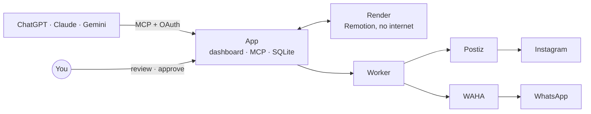

# Rīga Weekend

A self-hosted publishing desk for weekends in Riga. AI assistants (ChatGPT, Claude, Gemini) do the research and the creative work through this app's MCP server. The app renders the images and videos. You review and approve everything on a dashboard, then Postiz publishes to Instagram and WAHA sends the WhatsApp roundup.

**Nothing goes out without you.** Approving is a button, WhatsApp is a separate button, and `LIVE_PUBLISH=false` (the default) holds all delivery.

## What it does

| Part | What it does |
| --- | --- |
| **Weekend editions** | The week's events become one Instagram carousel per day, optional Stories and a WhatsApp digest. You choose the events, add photos and pick colours before approving. |
| **Story videos** | A day's best cards become an animated Story or Reel, sent to Postiz as a draft. |
| **Animations** | Standalone animated stories for single events, from the Remotion compositions in `remotion/src`. |
| **Animated edits** | Upload your own footage, or start from a blank canvas, and an assistant edits it: cuts, titles, stickers, drawn moments, 3D models, colour grading, depth effects, camera tracking, and generated voiceover, sound effects and music. |
| **Assistants together** | ChatGPT, Claude and Gemini hand work to each other through a relay you can follow and step into on the dashboard. |



## Run it locally

You only need Docker with Compose.

```sh
sh scripts/bootstrap.sh                             # writes a private .env with generated secrets
docker compose build
docker compose up -d app worker render
docker compose run --rm app node src/cli.js demo    # two fictional events to look at
```

Open http://localhost:3100 and sign in as `admin` with the `ADMIN_TOKEN` from `.env`.

| Also run | Command | Opens at |
| --- | --- | --- |
| Postiz | `docker compose up -d postiz` | http://localhost:4007 |
| WhatsApp (WAHA) | `docker compose --profile whatsapp up -d waha` | http://localhost:3001 |
| Remotion Studio | `cd remotion && npm install && npm run studio` | http://localhost:3000 |

Stop with `docker compose down`. Never add `--volumes` unless you mean to delete the databases, media and WhatsApp session.

## The dashboard

- **Weekend editions:**
  - run research
  - review editions: tick events and Stories, add photos, set days and colours
  - approve, send the WhatsApp digest
  - build story grids and their videos
  - **Your footage:** clips and blank animations, every edit version, previews and renders to watch and download
  - **Render history:** every render ever made
- **Animations:** render a standalone composition and send it to Postiz as a draft.
- **ChatGPT ↔ Claude:** relay threads, whose turn it is, what changed, and a box to step in.

## Connect the assistants

Every assistant uses the same address, `https://YOUR-DOMAIN/mcp`. Each signs in on the app's own login page with the admin token or a personal login.

| Assistant | How | Guide |
| --- | --- | --- |
| ChatGPT | Developer mode → Plugins → Create app, authentication OAuth. Press **Refresh** on the plugin after a deploy. | [Weekly research](docs/chatgpt-task.md), [animated edits](docs/chatgpt-video.md) |
| Claude | Settings → Connectors → Add custom connector | [Relay](docs/claude-relay.md) |
| Claude Code | `claude mcp add --transport http riga-weekend https://YOUR-DOMAIN/mcp`, then `/mcp` to sign in | [Relay](docs/claude-relay.md) |
| Gemini | Custom MCP connector | [Relay](docs/claude-relay.md) |

Weekly research has one owner: either the ChatGPT scheduled task, or the optional worker on the server (`OPENAI_API_KEY`, separate API charges). Never both.

## Other people

Everyone shares one workspace. Give each person their own login instead of the admin token:

```sh
scripts/remote.sh user add anna      # prints the password once
scripts/remote.sh user list
scripts/remote.sh user remove anna   # ends their dashboard login and assistant connections
```

A login can do everything the admin can, including approving, so only add people you would trust with the token.

## Deploy

An x86 VPS with 4 vCPU, 8 GB RAM and 80 GB disk is enough; no GPU is needed. [docs/go-live.md](docs/go-live.md) is the step-by-step checklist:

1. server and DNS
2. Instagram through Postiz
3. WhatsApp through WAHA
4. the assistants
5. a staged switch to live publishing

After that, `scripts/remote.sh` runs everything over SSH. Set `VPS_HOST` in `.env.deploy` first.

| Command | What it does |
| --- | --- |
| `deploy` | Copy the code to the server, rebuild and restart |
| `env` | Edit the server's `.env`, then restart app, worker and Postiz |
| `check` | List settings that are still missing |
| `logs`, `ps` | Follow the app and worker logs; container status |
| `backup` | Download the app data and the WhatsApp session |
| `user add\|remove\|list` | Logins for other people |
| `integrations`, `groups` | Find the Postiz integration ID and the WhatsApp group ID |
| `registration open\|close` | Let you create the Postiz admin account |
| `tunnel` | Open the server's WAHA dashboard at http://localhost:3011 |

## Settings you will touch

Every setting is in [.env.example](.env.example), with a comment.

| Setting | What it is for |
| --- | --- |
| `LIVE_PUBLISH` | Keep `false` until the accounts are connected and a preview cycle looks right |
| `AUTO_APPROVE` | Auto-approve the server worker's own research (never MCP submissions) |
| `APP_ORIGIN`, `APP_DOMAIN`, `POSTIZ_DOMAIN`, `POSTIZ_PUBLIC_URL` | Your domains |
| `POSTIZ_API_KEY`, `INSTAGRAM_INTEGRATION_ID`, `INSTAGRAM_PROVIDER` | Instagram through Postiz |
| `WAHA_CHAT_ID` | The WhatsApp group (`…@g.us`) |
| `SHORT_LINK_BASE`, `EJUZ_API_KEY` | Short links in captions (optional) |
| `ELEVENLABS_API_KEY`, `ELEVENLABS_CREDIT_CAP` | Generated sound (optional) and its spending cap |
| `FOOTAGE_MAX_MB`, `FOOTAGE_MAX_SECONDS` | Upload limits for footage |

## Safety

- **Locked-down containers.** They run as non-root with read-only filesystems and dropped capabilities. Running containers never mount the project folder or the Docker socket.
- **Only Caddy faces the internet.** The app, Postiz and WAHA listen on localhost only, and the render service has no internet access at all.
- **Secrets stay in `.env`.** It is git-ignored, and `bootstrap.sh` never prints the secrets it generates.
- **Delivery is recorded in a queue.** Nothing is sent twice by accident, and an unclear outcome (a timeout) waits for you to check rather than retrying. See [docs/publishing.md](docs/publishing.md#the-delivery-queue).

## Tests

```sh
docker compose --profile test build test
docker compose --profile test run --rm test
```

The tests run in a container with no network, credentials or data. With Node 24+ installed, `npm test` works too. Live accounts (Instagram, WhatsApp, the assistants' sign-in) are not covered.

## Project layout

| Path | What is there |
| --- | --- |
| `src/` | The app: MCP tools, dashboard API, card rendering, delivery, relay |
| `public/` | The dashboard |
| `remotion/` | The render service and every composition: story openers, animations, `FootageEdit`, the trailer |
| `test/` | Tests |
| `scripts/`, `deploy/` | Setup, remote control over SSH, VPS provisioning, Caddy |
| `tools/` | One-off asset builders (the storybook 3D model, story sound effects) |

## Docs

| Doc | About |
| --- | --- |
| [publishing.md](docs/publishing.md) | How editions are built, captioned, linked and delivered |
| [go-live.md](docs/go-live.md) | Setting up the server and accounts, step by step |
| [chatgpt-task.md](docs/chatgpt-task.md) | Connecting ChatGPT and the weekly research prompt |
| [chatgpt-video.md](docs/chatgpt-video.md) | Animated edits over your own footage |
| [claude-relay.md](docs/claude-relay.md) | ChatGPT, Claude and Gemini working together |
| [handoff.md](docs/handoff.md), [handoff-video.md](docs/handoff-video.md) | Where things stand, for picking work up in a new chat |
