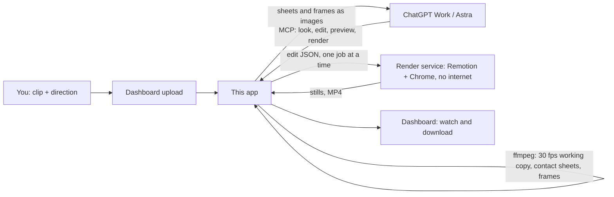

# Animate your own footage from ChatGPT

Upload a clip on the dashboard, then direct the edit in ChatGPT (Work mode with GPT-6 Astra, or any chat with the plugin enabled). ChatGPT looks at frames, writes the edit as JSON, checks rendered previews and asks for the video. This server does the frame-by-frame work and renders with Remotion. Nothing is published: the MP4 waits on the dashboard for you to watch and download.

All the AI work happens in ChatGPT, on your plan. The server never calls a model or any paid API. What it runs is ffmpeg and Remotion, on the VPS's own CPU.

## Set up once

1. Deploy this version: `scripts/remote.sh deploy`. This rebuilds the render service with the new `FootageEdit` composition.
2. The plugin you created for the weekend task already points at `https://events.YOUR-DOMAIN/mcp`. In ChatGPT (Developer mode on), open it on the Plugins page and press **Refresh** so the new tools appear. For a new plugin, follow [chatgpt-task.md](chatgpt-task.md): same URL, OAuth.
3. Start a Work session and turn the plugin on for it.

## Check these first (five minutes)

These depend on your ChatGPT account and could not be tested from here:

1. **The tools are there in Work.** Ask: "List my footage with the Riga Weekend plugin." You should get the clips from the dashboard.
2. **Astra can see the pictures.** Upload a short clip, then ask: "Show a contact sheet of that clip and tell me what happens in frame #3." Tools return contact sheets and frames as images. If the description matches the clip, Astra can see them. If it says it cannot see images, that is the one thing to fix before going further.
3. **Approvals.** ChatGPT may ask you to allow each call that changes something (`save_edit`, `preview_edit`, `render_edit`). None of them publishes anything; allowing them for the conversation is safe.
4. **Waiting.** `preview_edit` answers within about 45 seconds. When the renderer is busy it hands back a render id instead, and `get_render` picks the result up later. If Work gives up on tool calls sooner than that, tell me and the wait can be shortened.

## Directing an edit

A good opening message in Work:

> Use the Riga Weekend plugin. Clip: "pasta-review.mov". I want a vertical Reel of about 20 seconds. Open on the table with the title "Best pasta in Rīga?". When the fork lifts the tagliatelle, freeze for two seconds and turn it into a cel drawing, with steam and a callout "Hand-rolled tagliatelle" pointing at the fork, then back to the footage. Read get_edit_guide first. Sample the clip to find the moments, place anchors with get_frame, save the edit, and preview the frames either side of every transition. Show me the preview sheets and fix what is off, then render a draft. Don't render the final until I say so.

Then react to what you see: "the callout covers the plate, move it up", "hold the drawing a second longer", "try the ink style". Every save is a new version, so you can go back ("render version 3 again").

What ChatGPT can do in an edit:

| Layer | What it does |
|---|---|
| `timeline` | Cut the clip: play ranges, freeze a frame (`hold`), slow motion or speed-up |
| `anchors` | Named points on things in the footage, keyframed over time, so overlays follow them |
| `text` | Title, caption, callout card with a pointer line, tag, handwritten accent, full-width band |
| `sticker` | Steam, sparkles, hearts, stars, circle, arrow, underline, squiggle, burst, pulse, all animated |
| `illustrate` | Redraw the footage as a drawing (cel, ink, sketch, watercolor, duotone, posterize), with a fade, wipe or iris in and out, and a hand-drawn "boil" |
| `image` | A picture you uploaded, either on screen or lined up exactly over the footage |
| `zoom` | Push in towards, or follow, an anchor |
| `shake`, `flash` | Camera shake and a flash, for moments of impact |

The format is checked before it is saved. An edit is data, never code, so ChatGPT cannot make the renderer do anything the composition does not offer, and it cannot reach any file or address.

## Hand-illustrated moments

The drawing styles are filters: they need no image generation and cost nothing extra. For a real illustration of a moment:

1. Ask ChatGPT for `get_frame` of the frame to illustrate, with `grid: false`.
2. Have ChatGPT's image generation redraw it at the same shape (a vertical frame stays vertical). Download the image.
3. On the dashboard, under the clip's **Pictures**, add it with a name such as `pasta-drawn`.
4. Ask ChatGPT to use it: `{"type": "image", "asset": "pasta-drawn", "place": "footage", …}`. It then lines up with the footage exactly, and can cross-fade in and out on a freeze.

ChatGPT cannot pass an image it generated to the server directly, so this step goes through you.

## Limits

- Uploads: up to 1 GB and 10 minutes per clip (`FOOTAGE_MAX_MB`, `FOOTAGE_MAX_SECONDS` in `.env`). Every clip becomes a 30 fps H.264 working copy, upright, at most 1080×1920 (or 1920×1080). Phone HDR is converted to normal colour, and the original upload is deleted once the copy exists.
- Output: up to 3 minutes, as vertical (1080×1920), portrait (1080×1350), square or landscape.
- Speed: one render at a time, story videos included, with up to four waiting per clip. On a 4-core test machine, preview stills took 1–2 s each at half size, and a 5.5 s edit with a drawn section rendered in about 30 s as a draft and 35 s at full size. The VPS's shared vCPUs may be slower, so allow a minute or two per 10 s of video, more with long drawn sections.
- Disk: working copies and renders stay until you delete the clip on the dashboard.
- There is no automatic object tracking yet. ChatGPT places anchors from the frames it looks at, which suits a single clip; tracking can be added later if hand-placed anchors are not precise enough.

## Tools

| Tool | Changes anything? | Purpose |
|---|---|---|
| `list_footage` | no | Clips, their status and length, pictures, edit versions and recent renders |
| `sample_footage` | no | Contact sheet with SOURCE frame numbers and times |
| `get_frame` | no | One frame with a 0–1 coordinate grid, optionally zoomed into a region |
| `get_edit_guide` | no | The edit format, with a worked example |
| `get_edit` | no | A saved edit, its timeline and versions |
| `save_edit` | saves a version | Check and store an edit |
| `preview_edit` | renders stills | Real renders of chosen OUTPUT frames, as one sheet |
| `render_edit` | renders a video | Draft (half size) or final MP4 in the background |
| `get_render` | no | Progress, and frames from the result when ready |

Uploading, pictures, deleting and downloading stay on the dashboard, behind your login.
