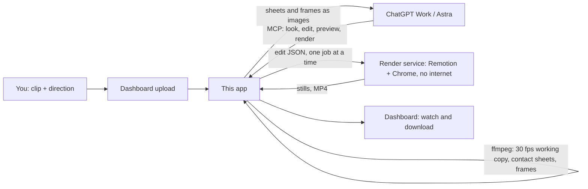

# Animate your own footage from ChatGPT

Upload a clip on the dashboard, then direct the edit in ChatGPT (Work mode with GPT-6 Astra, or any chat with the plugin enabled). ChatGPT looks at frames, writes the edit as JSON, checks rendered previews and asks for the video. This server does the frame-by-frame work and renders with Remotion. Nothing is published: the MP4 waits on the dashboard for you to watch and download.

All the AI work happens in ChatGPT, on your plan. The server never calls a model or any paid API. What it runs is ffmpeg and Remotion, on the VPS's own CPU.

## Set up once

1. Deploy this version: `scripts/remote.sh deploy`. This rebuilds the render service with the new `FootageEdit` composition.
2. The plugin you created for the weekend task already points at `https://events.YOUR-DOMAIN/mcp`. In ChatGPT (Developer mode on), open it on the Plugins page and press **Refresh** so the new tools appear. For a new plugin, follow [chatgpt-task.md](chatgpt-task.md): same URL, OAuth.
3. Start a Work session and turn the plugin on for it.

## Check these first (five minutes)

These depend on your ChatGPT account and could not be tested from here:

1. **The tools are there in Work.** Ask: "List my footage with the Riga Weekend plugin." You should get the clips from the dashboard.
2. **Astra can see the pictures.** Upload a short clip, then ask: "Show a contact sheet of that clip and tell me what happens in frame #3." Tools return contact sheets and frames as images. If the description matches the clip, Astra can see them. If it says it cannot see images, that is the one thing to fix before going further.
3. **Approvals.** ChatGPT may ask you to allow each call that changes something (`save_edit`, `preview_edit`, `render_edit`). None of them publishes anything; allowing them for the conversation is safe.
4. **Waiting.** `preview_edit` answers within about 45 seconds. When the renderer is busy it hands back a render id instead, and `get_render` picks the result up later. If Work gives up on tool calls sooner than that, tell me and the wait can be shortened.

## Directing an edit

A good opening message in Work:

> Use the Riga Weekend plugin. Clip: "pasta-review.mov". I want a vertical Reel of about 20 seconds. Open on the table with the title "Best pasta in Rīga?". When the fork lifts the tagliatelle, freeze for two seconds and turn it into a cel drawing, with steam and a callout "Hand-rolled tagliatelle" pointing at the fork, then back to the footage. Read get_edit_guide first. Sample the clip to find the moments, place anchors with get_frame, save the edit, and preview the frames either side of every transition. Show me the preview sheets and fix what is off, then render a draft. Don't render the final until I say so.

Then react to what you see: "the callout covers the plate, move it up", "hold the drawing a second longer", "try the ink style". Every save is a new version, so you can go back ("render version 3 again").

What ChatGPT can do in an edit:

| Layer | What it does |
|---|---|
| `timeline` | Cut the clip: play ranges, freeze a frame (`hold`), slow motion or speed-up |
| `anchors` | Named points on things in the footage, keyframed over time, so overlays follow them |
| `text` | Title, caption, callout card with a pointer line, tag, handwritten accent, full-width band |
| `sticker` | Steam, sparkles, hearts, stars, circle, arrow, underline, squiggle, burst, pulse, all animated |
| `illustrate` | Redraw the footage as a drawing (cel, ink, sketch, watercolor, duotone, posterize), with a fade, wipe or iris in and out, and a hand-drawn "boil" |
| `image` | A picture you uploaded, either on screen or lined up exactly over the footage |
| `sequence` | Frame-by-frame animation from an uploaded sprite sheet (all frames in one row): flapping wings, a turntable of a 3D object, a hand-drawn flicker |
| `path` (on images, sequences, graphics, models and stickers) | Flies it through the frame along smoothed keyframes, even during a freeze; the last key can land exactly on an anchor, and `facing: "path"` turns it the way it flies |
| `graphic` | Shapes ChatGPT draws and animates itself (keyframed position, rotation around a pivot, scale, opacity, draw-on, repeats for particles); `save_graphic` keeps one by name for reuse |
| `model` | A 3D model (.glb) placed in the shot and played through its own animations (walk, idle, sit…), switching between them at set frames; it can walk along a path facing the way it goes, is lit from the side you choose, casts a soft shadow, and can be drawn as a toon with an ink outline |
| `depth` (on the edit and on moving layers) | With a depth source (per-frame depth for the clip, or a depth picture for a freeze), things pass behind nearer parts of the shot |
| `blur`, `fog`, `parallax` | Depth effects: depth of field around a focus, haze that thickens with distance, and a 2.5D camera move |
| `sounds` | Sound effects and music on exact frames: volume, fades, volume over time, looping, trimming, speed, pan, pitch, reverse, low/high-pass, bass/treble, echo, reverb, normalising; `duck` dips the clip's own sound under one, and `sourceVolume`/`sourceKeys` set the clip's sound over time |
| `zoom` | Push in towards, or follow, an anchor |
| `shake`, `flash` | Camera shake and a flash, for moments of impact |

The format is checked before it is saved. An edit is data, never code, so ChatGPT cannot make the renderer do anything the composition does not offer, and it cannot reach any file or address.

## Hand-illustrated moments

The drawing styles are filters: they need no image generation and cost nothing extra. For a real illustration of a moment:

1. Ask ChatGPT for `get_frame` of the frame to illustrate, with `grid: false`.
2. Have ChatGPT redraw it at the same shape (a vertical frame stays vertical), with image generation or with code in its sandbox.
3. ChatGPT sends it to the server itself: it asks `create_upload_link` for a one-time link and uploads the file from its sandbox (`curl --fail -T picture.png "<link>"`). The link needs no login, takes one picture for one clip, and expires after 30 minutes. Only a hash of it is stored. In a Work session this was tested: the sandbox can make outbound uploads, and generated images are saved there as files.
4. Ask ChatGPT to use it: `{"type": "image", "asset": "pasta-drawn", "place": "footage", …}`. It then lines up with the footage exactly, and can cross-fade in and out on a freeze.

`add_picture` is a second route. It takes a file from the conversation (through ChatGPT's file parameters) or a public HTTPS link, and fetches it with the same guards as event posters. ChatGPT's file handover is documented but has known gaps, so the upload link is the one to rely on. You can still add pictures by hand on the dashboard, under the clip's **Pictures**.

## Limits

- Uploads: up to 1 GB and 10 minutes per clip (`FOOTAGE_MAX_MB`, `FOOTAGE_MAX_SECONDS` in `.env`). Every clip becomes a 30 fps H.264 working copy, upright, at most 1080×1920 (or 1920×1080). Phone HDR is converted to normal colour, and the original upload is deleted once the copy exists.
- Output: up to 3 minutes, as vertical (1080×1920), portrait (1080×1350), square or landscape.
- Speed: one render at a time, story videos included, with up to four waiting per clip. On a 4-core test machine, preview stills took 1–2 s each at half size, and a 5.5 s edit with a drawn section rendered in about 30 s as a draft and 35 s at full size. The VPS's shared vCPUs may be slower, so allow a minute or two per 10 s of video, more with long drawn sections.
- Disk: working copies and renders stay until you delete the clip on the dashboard.
- There is no automatic object tracking yet. ChatGPT places anchors from the frames it looks at, which suits a single clip; tracking can be added later if hand-placed anchors are not precise enough.

## Tools

| Tool | Changes anything? | Purpose |
|---|---|---|
| `list_footage` | no | Clips, their status and length, pictures, edit versions and recent renders |
| `sample_footage` | no | Contact sheet with SOURCE frame numbers and times |
| `get_frame` | no | One frame with a 0–1 coordinate grid, optionally zoomed into a region |
| `get_edit_guide` | no | The edit format, with a worked example |
| `get_edit` | no | A saved edit, its timeline and versions |
| `save_edit` | saves a version | Check and store an edit |
| `preview_edit` | renders stills | Real renders of chosen OUTPUT frames, as one sheet |
| `render_edit` | renders a video | Draft (half size) or final MP4 in the background |
| `get_render` | no | Progress, and frames from the result when ready |
| `save_graphic`, `list_graphics` | saves / no | A library of animated graphics reused by name |
| `create_download_link` | makes a link | The clip's working copy for 30 minutes, e.g. to compute depth in ChatGPT's sandbox |
| `make_depth` | starts a job | Per-frame depth for the clip, made on the server in the background |
| `get_depth` | no | Depth values (0 far – 1 near) at points, plus the depth picture |
| `create_upload_link` | makes a link | One-time link for ChatGPT to upload a picture, a 3D model (.glb), a sound, or the clip's per-frame depth video, from its sandbox |
| `add_picture` | stores a picture | A file from the conversation, or a public HTTPS link |
| `add_sound` | stores a sound | An audio file from the conversation, or a public HTTPS link to one |
| `add_model` | stores a 3D model | A .glb from the conversation, or a public HTTPS link; for a sandbox that cannot reach the upload link |

Uploading footage, deleting and downloading stay on the dashboard, behind your login. The upload link is the only route without a login, and it accepts nothing but the one picture, model or depth video it was made for.

## 3D models

A model layer draws a real 3D model in the shot with Three.js, inside the same render. It suits a character that has to move believably: a cat walking round the cup and sitting on the saucer, a bird landing, a product turning on a turntable.

1. Get an animated, low-poly model as one binary glTF file (`.glb`, textures embedded). Free sources: [Poly Pizza](https://poly.pizza) (CC0 animals and characters, many by Quaternius with walk, idle and sit animations), Sketchfab (download as glTF binary; check the licence), Mixamo (characters with walk cycles, converted to GLB in Blender). ChatGPT can also build simple ones in its sandbox.
2. ChatGPT uploads it with `create_upload_link` kind `model`. When its sandbox has no network (normal ChatGPT chats often do not), it hands the file over with `add_model` and the server fetches it; or you download the file and add it on the dashboard under the clip's **3D models**. The server checks it and lists its animations by name.
3. The edit places it with `at` or a `path`, picks animations by name and switches between them with `actions`, and sets `size`, `tilt` (how far the camera looks down, to match the footage), `light` (where the light in the shot comes from) and `shadow`. `look: "toon"` draws it like a cartoon with an ink outline, to match illustrated moments.

Models are checked on upload: at most 50 MB and 400,000 triangles, everything inside the one file, and no Draco or KTX2 compression (the renderer cannot decode them; re-export without compression). There is no camera tracking: a model follows anchors and paths on screen, and does not match a moving camera's perspective. It works best on a still or slowly moving shot, or on a freeze. On handheld footage, give it `follow` with an anchor on the table so its path moves with the shot; plain models without colours can be tinted with `color`. `depth: "auto"` reads the ground's depth under its feet each frame, so it walks behind the cup without the table cutting off its legs; `stride` ties the walk cycle to the distance moved, so its feet do not slide; `front` says which way a model faces as made, when it is not the glTF standard of facing the camera. On a 4-core test machine a 4 s draft with two models rendered in about 40 s.

## Depth

The easiest way is `make_depth` (or **Make depth** on the dashboard, under the clip's **Depth**): the server runs Depth Anything V2 Small (Apache-2.0) over every frame in a separate low-priority process and stores the result like an uploaded depth video. The model, about 100 MB, downloads from Hugging Face the first time and is kept under the data folder (`DEPTH_MODEL` can point at a copy you placed yourself). Expect well under a second per frame on 4 cores, so a few minutes for a 10 s clip; clips up to `DEPTH_MAX_SECONDS` (120 s), with `DEPTH_DETAIL` (392) setting how much detail the model sees. The first real run on your server is also the first test of the real model's speed and quality: this was built and tested with a stand-in model because Hugging Face was not reachable from the build machine.

ChatGPT can also compute depth itself: it downloads the clip with `create_download_link`, runs a depth model (such as Depth Anything V2) in its sandbox, and uploads a greyscale depth video (near = white, one frame per clip frame, normalised across the whole clip so it does not flicker) with `create_upload_link` kind `depth`. The server checks the frame count and stores small depth frames the renderer reads. A depth picture for a single frozen frame works the same way, uploaded as a picture. Edits then say where depth comes from (`"depth": {"video": true}` or stills for a freeze), give moving layers a `depth`, and can add `blur`, `fog` and `parallax`.
