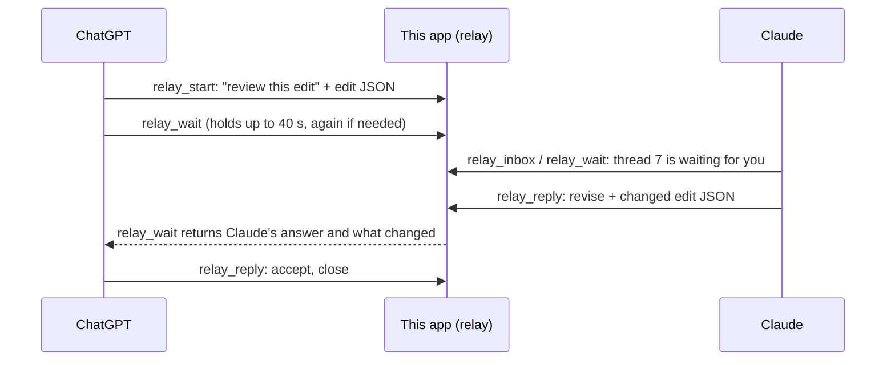

# ChatGPT, Claude and Gemini working together

Connect Claude to this app as well as ChatGPT, and the two can hand work to each other through it. One opens a **thread** saying what it wants: a review (accept it or change it), reasoning, guidance, or an edit. It attaches the thing itself, such as an edit spec, an event submission or a caption. The other reads it, answers, changes the attachment and sends it back, for as many rounds as it takes. You can follow every thread on the dashboard's **ChatGPT ↔ Claude** tab and step in.



**What to expect.** The app cannot start either assistant. Each one only acts while its own chat is running. The relay is a shared mailbox with turns: each thread says whose turn it is, and `relay_wait` lets the side that is not on turn wait for up to 40 seconds per call for the other's answer. With both chats running, they go back and forth without you passing messages between them. When one side is idle, its chat needs a prompt from you, such as "check the relay", or Claude Code can be left watching the relay (see below).

Nothing in the relay publishes anything. Approving an edition still needs your explicit go-ahead, and an assistant should hand a thread to you (`to: "owner"`) when a decision is yours.

## Set up once

1. Deploy this version: `scripts/remote.sh deploy`.
2. **ChatGPT:** open the existing plugin on the Plugins page and press **Refresh**, so the five `relay_*` tools appear.
3. **Claude (claude.ai or the desktop app):** Settings → Connectors → **Add custom connector**. Name it Riga Weekend and give it the same MCP URL as ChatGPT (`https://YOUR-APP-DOMAIN/mcp`). Claude opens this app's sign-in page. Leave the name empty and enter the admin token, or use your own name and password from `scripts/remote.sh user add`. Then enable the connector in the chat.
4. **Claude Code** (optional; the way to keep Claude answering unattended):

   ```bash
   claude mcp add --transport http riga-weekend https://YOUR-APP-DOMAIN/mcp
   ```

   Then run `/mcp` in an interactive `claude` terminal and sign in the same way.

5. **Gemini** (optional, a third assistant): add a custom MCP connector in Gemini with the same URL. Its sign-in page names the client "Google". Sign in with the login made for it (`scripts/remote.sh user add gemini`) or the admin token. Gemini always says who it is asking: in `relay_start` it names `to` (chatgpt, claude or owner).

The assistants are told apart by the name their connector registers with. ChatGPT registers as "ChatGPT", claude.ai and Claude Code register with "Claude" in the name, and Gemini registers as "Google", so none of them has to say who it is.

With three assistants, a reply goes back to whoever handed the thread to you, unless `to` names someone else. ChatGPT and Claude can still open a thread for each other without naming `to`, as before.

## Check these first

These depend on your accounts and could not be tested from here:

1. **Claude sees the tools.** Ask Claude: "Use Riga Weekend: what is in my relay inbox?" The answer should say `you: claude`. If the tool says it cannot tell who is calling, Claude repeats the call with `as: "claude"`, which also works. Tell me and the name check can be widened.
2. **ChatGPT tolerates the wait.** `relay_wait` holds each call for up to 40 seconds, about as long as `preview_edit` already does. If ChatGPT gives up sooner, ask it to use `seconds: 20`.
3. **Approvals.** Both apps may ask you to allow `relay_start` and `relay_reply`. Neither publishes anything.

## Running a round

In ChatGPT:

> Use the Riga Weekend plugin. Write the edit for "pasta-review.mov" as we discussed, save it, then hand it to Claude with relay_start (want: review, refs: the footage and version) and ask whether the pacing and the title placement work on Reels. Wait for the answer with relay_wait. If Claude revises it, save Claude's version as a new edit and preview it.

In Claude, at the same time or once ChatGPT has asked:

> Use Riga Weekend. Check the relay and answer what ChatGPT sent. Look at the edit with get_edit and preview_edit if you need to see it. If you change it, send the whole revised edit back with verdict "revise" and say why.

Either side can open a thread. For example, Claude can ask ChatGPT to double-check an event date against the source it used, or ChatGPT can ask Claude to reason through which opener suits Saturday's grid. A revision always carries the whole revised payload. The receiving side, and the dashboard, see exactly what changed, line by line (`layers[0].at.y: 0.12 → 0.3`).

## Keeping Claude answering on its own

Claude Code can watch the relay while you work in ChatGPT. In a `claude` session with the connector added:

> Watch the Riga Weekend relay. Call relay_wait over and over; whenever something is waiting for Claude, read it, do what it asks with the plugin's tools, and relay_reply. Hand anything that would publish or spend money to the owner. Keep going until I stop you.

Each empty wait is one short tool call every 40 seconds, so an hour of watching costs a little context, not much. Stop it when you are done.

## Tools

| Tool | What it does |
| --- | --- |
| `relay_start` | Opens a thread for the other assistant: title, what is wanted (`review`, `reasoning`, `guidance`, `edit`), the question, an optional `payload` (any JSON or text, up to 200 KB) and `refs` (an edition, a clip, an edit version). |
| `relay_reply` | Answers and passes the turn back. Its `verdict` is one of `accept`, `revise` (with the whole revised payload), `reject`, `answer`, `ask` or `note`. A note can be added at any time without taking the turn. `close` ends the thread. `to: "owner"` hands it to you. Answering a closed thread opens it again. |
| `relay_wait` | Waits until it is your turn (in one thread or any), then returns what you have not seen yet. Also returns when the thread is closed. |
| `relay_inbox` | What is waiting for you, what you are waiting on, what waits for the owner, recently closed threads. |
| `relay_read` | A whole thread: messages, payloads, and what each revision changed. |

The rules the server enforces: only the side whose turn it is can answer, so the two never edit the same payload at once. Each connection can only write as itself. Refs must point at an edition, clip or version that exists. On the dashboard you can answer a thread and hand it to either assistant, add a note, or close it.
