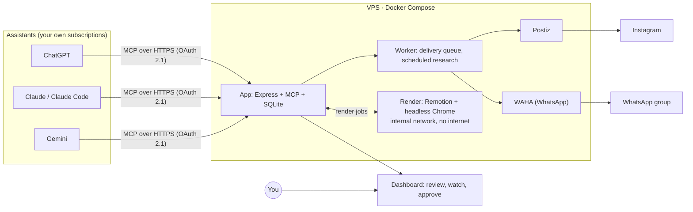
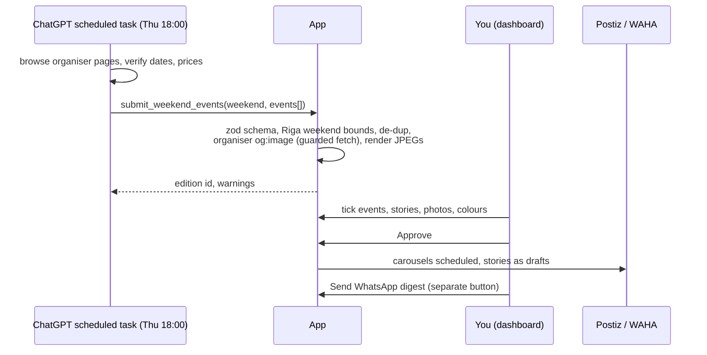
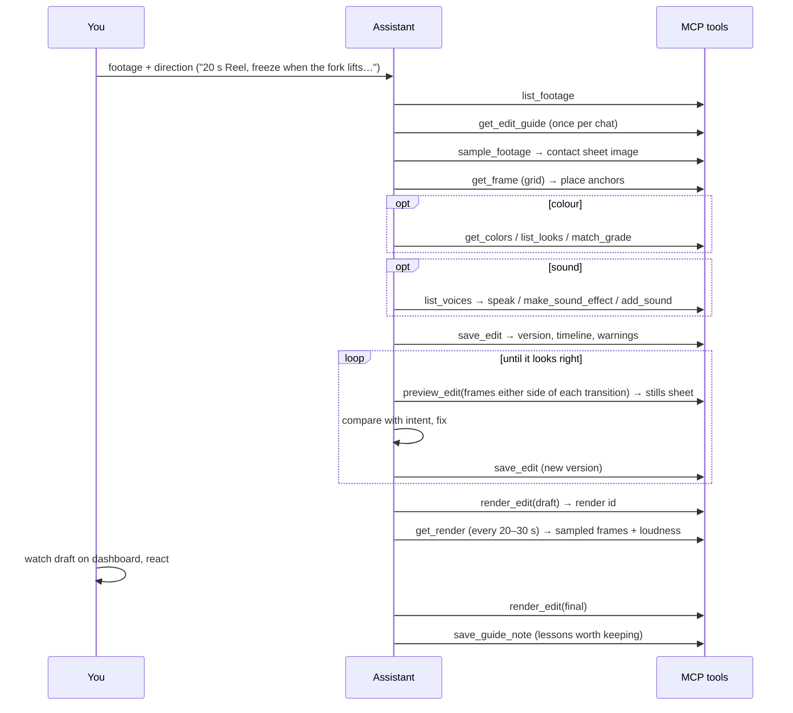
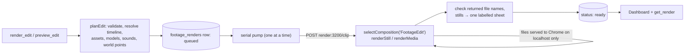
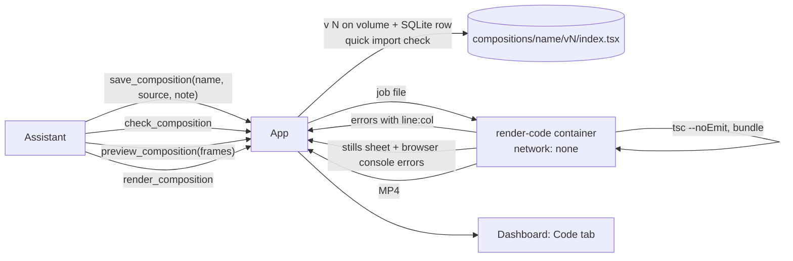

# How Rīga Weekend works: pipeline, MCP tools and dashboard

This guide is for anyone building something similar. It covers:

1. the system as it runs today,
2. how its MCP tools are organised and the order assistants call them in,
3. the dashboard used to follow the work,
4. how to extend it so an assistant can write Remotion `.tsx` animation files on the server itself. This last part is a design. It does not exist in this repository yet.

How several assistants work together on one server has its own document: [swarm.md](swarm.md).

`YOUR-DOMAIN` is a placeholder for the HTTPS domain the app runs on.

---

## 1. The idea in one picture

There is one server with one MCP endpoint. ChatGPT, Claude and Gemini connect to it as a plugin or connector, and they do all the thinking: researching events, writing animation edits, looking at frames and judging the results. The server does everything that must be exact and repeatable: validation, storage, image and video rendering, the publishing queue. A person watches and decides on a dashboard. Nothing is published until a person presses a button.



Two pipelines share the server:

| Pipeline | Flow |
| --- | --- |
| **Weekend editions** | research → `submit_weekend_events` → carousel and story images → review on dashboard → approve → Postiz (Instagram) / WhatsApp button |
| **Animated video** | your footage or a blank canvas → assistant looks at frames → writes an *edit* (JSON) → preview stills → render MP4 → watch and download on the dashboard |

A third layer sits on top: the **relay**, where the assistants hand work to each other. See [swarm.md](swarm.md).

---

## 2. The stack

| Part | What it is | Notes |
| --- | --- | --- |
| App | Node 24, Express 5, `@modelcontextprotocol/sdk`, zod, `node:sqlite`, sharp, luxon | Serves MCP, the dashboard and its JSON API, and renders the carousel images (SVG → JPEG) |
| Worker | Same image, `node src/cli.js worker` | Delivery queue to Postiz/WAHA, optional scheduled research. Run exactly one |
| Render | Remotion 4, Chrome Headless Shell, React 19, three.js / `@react-three/fiber` | Its own container, on an internal Docker network that cannot reach the internet. One render at a time |
| Media | ffmpeg/ffprobe, Depth Anything V2 Small (onnxruntime-node), COLMAP (pycolmap) | 30 fps working copies, contact sheets, per-frame depth, camera tracks |
| Generated sound | ElevenLabs | Speech, sound effects, music. Requests are cached and spending is capped |
| Publishing | Postiz (self-hosted), WAHA, ej.uz short links (optional) | Postiz owns the Instagram schedule |
| Edge | Caddy | HTTPS for the app and Postiz |

**Main rule:** for the video work, the server never calls a model. The assistants do the thinking, on your own ChatGPT or Claude plans, and the server only runs tools. There are two exceptions. The optional OpenAI research worker calls a model, and ElevenLabs is called when an assistant asks for generated sound.

The containers are hardened. The app and render containers run as non-root with `cap_drop: ALL`, `no-new-privileges` and read-only root filesystems where possible. Data lives in named volumes. Service ports bind only to localhost, and in production only Caddy faces the internet.

---

## 3. How the MCP server is organised

### One stateless endpoint

`POST /mcp` builds a fresh `McpServer` for every request, registers the tools, answers that one request and closes. All state is in SQLite. Restarts, several clients at once and reconnects therefore need no special handling.

```js
// src/app.js (shortened)
app.post('/mcp', async (req, res) => {
  const server = new McpServer({ name: 'riga-weekend', version: '0.1.0' }, { instructions: RELAY_INSTRUCTIONS });

  server.registerTool('submit_weekend_events', { description, inputSchema: Submission.shape }, submit);
  server.registerTool('list_weekend_editions', { description, inputSchema: {} }, list);
  animator.register(server);   // 35 footage / animation / sound / render tools
  relay.register(server);      // 5 relay tools
  server.registerTool('approve_weekend_edition', { ..., annotations: { destructiveHint: true } }, approve);

  const transport = new StreamableHTTPServerTransport({ sessionIdGenerator: undefined, enableJsonResponse: true });
  res.on('close', () => { transport.close(); server.close(); });
  await server.connect(transport);
  await transport.handleRequest(req, res, req.body);
});
```

### Each feature is one module

| Module | MCP tools | Also owns |
| --- | --- | --- |
| `src/app.js` | `submit_weekend_events`, `list_weekend_editions`, `approve_weekend_edition` | Editions, review API, delivery |
| `src/animate.js` | 35 tools (footage, edits, assets, colour, depth, tracking, sound, renders) | Upload routes, render queue, dashboard API for clips |
| `src/relay.js` | `relay_start`, `relay_reply`, `relay_wait`, `relay_inbox`, `relay_read` | Relay tables, `/api/relay` for the dashboard tab |

Each module is a `createX(app, store, options)` that mounts its own dashboard routes and returns `{ register(server) }`. Each feature therefore lives in one place: its tables, its MCP tools and its dashboard API. There are 43 tools in total.

### Auth and identity

- **The app is its own OAuth 2.1 authorization server.** It serves `/.well-known/oauth-authorization-server`, supports dynamic client registration, requires PKCE and has a login page on your domain. ChatGPT custom apps need OAuth, since they offer no API-key option. Claude custom connectors, Claude Code (`claude mcp add --transport http …`) and Gemini use the same flow.
- **Logins.** You can sign in with the admin token, or with a personal name and password created by `scripts/remote.sh user add NAME`. Only a hash of the password is kept, and `user remove` cuts that person's connections immediately.
- **Tokens.** An access token lasts 1 hour and a rotating refresh token lasts 90 days. Both are scoped to `/mcp` only, so they cannot call the dashboard API.
- **Who is calling.** Each OAuth client registers under a name ("ChatGPT", "Claude …", "Google"). The relay uses that name to know which assistant is calling, so assistants don't have to say who they are.

### Tool conventions that make models reliable

This is the part most worth copying.

1. **Edits are data, not code.** `save_edit` takes JSON that zod checks against the clip. The renderer can only do what the Remotion composition offers, and an edit cannot reach any file or address. Section 8 relaxes this on purpose.
2. **A guide tool.** `get_edit_guide` returns the edit format, the two frame clocks, coordinates, a worked example and tips. Tool descriptions tell the model to read it first.
3. **House rules as memory.** `save_guide_note` adds a rule to the end of the guide. Lessons ("sprite-first effects", "never put text over faces") therefore carry over to every later chat and every assistant. The limit is 40 notes.
4. **Boards translate taste into settings.** `list_looks` (colour grades) and `list_voices` (narration deliveries) are named rows that say when each one fits and which settings it uses. A model cannot hand "read it sadly" to an API, but it can pick `cinematic-sad`.
5. **Tools return pictures, so the model checks real output:**
   - `sample_footage`: a contact sheet labelled with frame numbers
   - `get_frame`: one frame under a 0–1 coordinate grid
   - `preview_edit`: real rendered stills
   - `get_render`: frames sampled from the finished MP4, plus a loudness trace of the audio every quarter second
6. **Every answer says what to do next** in a `next` or `then` field. Errors are sentences the model can act on, such as *"Frame 412 is past the end of the edit (its last frame is 389)"*.
7. **Long work is queued, not awaited.**
   - `preview_edit` waits up to about 45 s, then hands back a render id.
   - `render_edit` returns at once.
   - `get_render` polls for the result.
   - Background jobs (`make_depth`, `make_track`) report progress through `list_footage`.
8. **Annotations.** Tools are marked with `readOnlyHint` or `destructiveHint`, so a client can allow reads and ask before writes. Only `approve_weekend_edition` and `delete_guide_note` are destructive.
9. **Everything is versioned.** Every `save_edit` creates a new version, renders point at a version, and the model can always go back ("render version 3 again").
10. **Schemas are written out each time.** Small zod factory functions build them instead of reusing one schema object. A reused schema object turns into a JSON `$ref`, which some clients read badly.
11. **Files move in and out without secrets.**
    - One-time 30-minute upload links: the assistant's sandbox runs `curl --fail -T file "<link>"`.
    - `add_*` tools take a file from the conversation or a public HTTPS link, guarded against private addresses.
    - Download links are also one-time and last 30 minutes.
12. **Anything paid has guards.**
    - ElevenLabs results are cached by the full request, so asking again is free and sounds identical.
    - Spending is capped against the account's own counter plus a local record, because the provider's counter lags.
    - `voice_budget` shows what is left.

---

## 4. The tool catalogue

"Changes" means the tool writes something. None of these tools publish anything, except that `approve_weekend_edition` queues publication.

### Weekend editions

| Tool | Changes | Purpose |
| --- | --- | --- |
| `submit_weekend_events` | saves, renders images | Source-checked events for one Friday–Sunday → carousels, stories, WhatsApp text. Saved for review |
| `list_weekend_editions` | – | Editions and delivery status |
| `approve_weekend_edition` | **queues publication** | Needs your explicit go-ahead. Actually sending also needs `LIVE_PUBLISH=true` on the server |

### Bringing material in

| Tool | Changes | Purpose |
| --- | --- | --- |
| `new_animation` | creates a canvas | A blank canvas (vertical, portrait, square or landscape) for animation with no footage |
| `add_video` | adds a clip | From a conversation file or HTTPS link. The server makes a 30 fps working copy |
| `create_upload_link` | makes a link | A one-time link for a picture, `.glb` model, sound, depth video, camera track or video |
| `add_picture`, `add_model`, `add_sound` | stores an asset | From a conversation file or HTTPS link |
| `build_sprite` | stores a picture | Lays out single frames as one sprite-sheet grid |
| `create_download_link` | makes a link | A clip's working copy (or its kept master) for 30 minutes |

### Looking

| Tool | Changes | Purpose |
| --- | --- | --- |
| `list_footage` | – | Clips, status, frames, assets, models, sounds, edit versions, recent renders, job progress |
| `sample_footage` | – | Contact sheet of up to 24 frames labelled with SOURCE frame and time |
| `get_frame` | – | One frame under a 0–1 grid, optionally zoomed into a region (for placing anchors) |
| `get_colors` | – | Main colours of a frame, levels, and which looks suit it |
| `get_depth` | – | Depth (0 far – 1 near) at points, plus the depth picture |
| `get_track` | – | The camera track with a checking picture (a grid drawn on the ground) |

### Analysis jobs on the server

| Tool | Changes | Purpose |
| --- | --- | --- |
| `make_depth` | starts a job | Per-frame depth with Depth Anything V2 Small, in the background |
| `make_track` | starts a job | Camera solve with COLMAP, so things stay put in the room as the camera moves |

### Writing the edit

| Tool | Changes | Purpose |
| --- | --- | --- |
| `get_edit_guide` | – | Edit format, workflow, worked example, then the house rules |
| `save_guide_note`, `delete_guide_note` | changes the guide | Rules the assistants keep for themselves |
| `get_edit` | – | A saved edit, its output↔source timeline, warnings, versions |
| `save_edit` | saves a version | Checked against the clip and its assets. Renders nothing |
| `save_graphic`, `list_graphics` | saves / – | A library of keyframed vector graphics reused by name |

### Colour

| Tool | Changes | Purpose |
| --- | --- | --- |
| `list_looks` | – | The grading board: named film looks and when they suit |
| `match_grade` | – | Measures two clips and returns a grade layer that brings one towards the other |

### Sound

| Tool | Changes | Purpose |
| --- | --- | --- |
| `list_voices` | – | The narration board, the account's voices and speech models |
| `set_style_voice` | pins a voice | Which voice reads a narration style |
| `speak` | adds a sound (paid) | Voiceover in a named delivery. Optional word-timed captions |
| `make_sound_effect`, `make_music` | adds a sound (paid) | From a plain description |
| `voice_budget` | – | Credits left, the cap, spending this month |

### Rendering

| Tool | Changes | Purpose |
| --- | --- | --- |
| `preview_edit` | renders stills | Chosen OUTPUT frames as one labelled sheet (waits about 45 s, else returns an id) |
| `render_edit` | renders a video | Draft (half size) or final MP4 in the background |
| `get_render` | – | Status. When ready: the sheet, or sampled frames plus a loudness trace |
| `list_renders` | – | Every render, newest first |

### Relay

`relay_start`, `relay_reply`, `relay_wait`, `relay_inbox`, `relay_read`. See [swarm.md](swarm.md).

---

## 5. The order assistants call the tools in

### 5a. A weekend edition



### 5b. An animated edit



**The two frame clocks** prevent the most common mistake. *SOURCE* frames are the numbers on contact sheets, used for anchors (where things are in the clip). *OUTPUT* frames are positions in the finished video, after cuts, freezes and speed changes, and every layer uses them. `save_edit` and `get_edit` return the mapping between the two.

### 5c. Inside the server during a render



Rules on the render side:

- One render at a time, with up to four waiting per clip.
- A busy renderer answers 409. The app waits 10 s and tries again.
- Timeouts are 5 minutes for stills and 60 minutes for video.
- The render service has no internet access. Chrome loads footage, pictures, models and sounds from the render container's own local file server.
- The app accepts only the file names it asked for.

---

## 6. The dashboard: where you follow progress

The same app serves the dashboard at `/`: `http://localhost:3100` locally, `https://YOUR-DOMAIN` in production. It sits behind Basic auth, using `admin` plus the token or a personal login. It is plain HTML plus one vanilla JS file (`public/app.js`), with no framework and no build step. It polls the JSON API every few seconds, and it redraws only when the data has actually changed.

Every MCP action leaves a record: an edit version with a note, a render with a status, a relay message. That makes the dashboard both a live log of what the assistants did and the place to watch the real output.

### Tab: Weekend editions

- **Research** button, status, and the history of research runs.
- **Editions:**
  - every candidate event with a publish tick and a Story tick
  - add or replace a photo
  - which days an event runs, and colour swatches per day
  - the rendered images, captions and WhatsApp text
  - delivery jobs with their state: queued, scheduled, sent, or *uncertain*, with Confirm and Retry buttons
- **Story grids:** pick up to six cards per day, build the grid, render the story video, send it to Postiz as a Reel or Story draft.
- **Your footage:**
  - **Upload a video**, with a progress bar
  - **Start an animation**, which makes a blank canvas
  - a card per clip:
    - status (Uploading / Processing n% / Ready / Failed), length, size, frames, HDR note
    - the latest edit version with its note, and every version with time and note
    - pictures, 3D models, sounds, depth and track jobs
    - renders: *Waiting for the renderer… / Rendering… / Failed: reason / ready*, with a video player, the sampled-frames sheet and **Download MP4**
- **Render history:** every render across all clips. Columns: when, from what, kind (stills / draft / final, with edit version), how it went, Watch / Download.
- **Import:** paste a JSON submission by hand.

### Tab: Animations

TSX compositions already in the render bundle (story openers, single-event stories), each rendered on its own by name. You set a name, the composition, how long it holds and a caption. You can then watch it and send it to Postiz as a draft.

### Tab: ChatGPT ↔ Claude

The relay threads, each with whose turn it is, messages with verdicts, and the payload changes line by line. There is an answer box, buttons to send to ChatGPT, Claude or Gemini, *Add a note*, and *Close the thread*. See [swarm.md](swarm.md).

### What only the dashboard can do

Some actions are deliberately left out of MCP:

- uploading footage from your own computer
- deleting
- downloading
- sending the WhatsApp digest
- by convention, approving

Anything that destroys, spends or goes public stays behind your own login.

### Building your own version

The minimum useful dashboard has four parts:

1. a list of jobs with live status
2. the rendered media inline (image or `<video>`)
3. the version list with the notes the assistant wrote
4. an inbox of whatever waits for you

Poll `/api/…` every 3–5 s and compare a signature (for example `JSON.stringify(rows.map(r => [r.id, r.status]))`) before redrawing. When showing anything an assistant wrote, insert it as text, never as raw HTML.

### Running it locally

```bash
docker compose up -d app worker render
```

Open `http://localhost:3100`. For working on TSX compositions with live preview:

```bash
npm --prefix remotion run studio
```

Studio opens at `http://localhost:3000`. It is also in `.claude/launch.json`, so Claude Code's preview pane can open it.

---

## 7. The two ways animations are made today

| | **Edit JSON** (`FootageEdit` composition) | **TSX compositions** (`remotion/src/*.tsx`) |
| --- | --- | --- |
| Written by | Any assistant, over MCP | Claude Code, in the repository, locally |
| Stored in | SQLite, versioned | git |
| Reaches the server | Instantly, with `save_edit` | On deploy: the render image is rebuilt, which bundles it |
| Can do | Everything the composition offers (a long layer list) | Anything React, Remotion or three.js can |
| Risk | None: it is data, validated | It is code, reviewed through git before deploy |
| Rendered from | Your footage / MCP tools | Animations tab, story openers |

The edit format's layers:

- **Timing:** `timeline` (cuts, freezes, speed ramps, reframing) and `anchors`.
- **On screen:**
  - `text`: five typefaces, reveals, loops, paths
  - `sticker`, `image`, `sequence` (sprite sheets), `particles`
  - `graphic`: keyframed vector shapes
  - `model`: `.glb` models through three.js, with animations, depth and shadows
- **Drawn and depth:** `illustrate` (redraws footage as cel, ink, sketch or watercolour) and depth-aware `blur`, `fog`, `parallax`.
- **Camera and look:** `zoom`, `shake`, `flash`, colour `grade`, `finish`, transitions.
- **Sound:** `sounds`, with fades, ducking, pitch and reverb.

A **hybrid** was used for a trailer. Claude Code wrote six three.js plates as TSX (`remotion/src/trailer/`) and rendered them locally on a Mac GPU. They were uploaded as video clips with `create_upload_link`, and ChatGPT then cut, titled, graded and mixed them as a normal edit.

---

## 8. Extension: letting an assistant write TSX on the server

> **Status: design only.** This repository keeps edits as data and puts all code through git. This section describes how to let ChatGPT or Claude (which cannot touch the repository) write and render `.tsx` compositions directly on the server, and what that requires to be safe.

**The gap:** any visual idea the edit format doesn't cover waits for a code change and a redeploy. **The fix:** treat a composition as versioned source that the server stores, checks, bundles and renders on demand.

### 8.1 Overview



### 8.2 The contract for a composition file

The assistant writes **one file**. It has a default-exported component, a `meta` object and optional `defaultProps`. The server writes the Remotion root and entry itself, so the assistant never touches registration.

```tsx
// compositions/rye-title/v3/index.tsx
import { AbsoluteFill, interpolate, random, spring, useCurrentFrame, useVideoConfig } from 'remotion';

export const meta = { width: 1080, height: 1920, fps: 30, durationInFrames: 150 };
export const defaultProps = { title: 'RUDZU RĪGA', accent: '#d4ed86', background: '#17352d' };

type Props = typeof defaultProps;

export default function RyeTitle({ title, accent, background }: Props) {
  const frame = useCurrentFrame();
  const { fps } = useVideoConfig();
  const rise = spring({ frame, fps, config: { damping: 14 } });
  const fade = interpolate(frame, [120, 150], [1, 0], { extrapolateLeft: 'clamp', extrapolateRight: 'clamp' });

  return (
    <AbsoluteFill style={{ background, opacity: fade, justifyContent: 'center', alignItems: 'center' }}>
      {Array.from({ length: 40 }, (_, i) => (
        <div key={i} style={{
          position: 'absolute', width: 6, height: 6, borderRadius: 3, background: accent,
          left: `${random(`x${i}`) * 100}%`,
          top: `${(random(`y${i}`) * 100 + frame * (0.2 + random(`s${i}`))) % 100}%`,
        }} />
      ))}
      <h1 style={{ color: accent, fontSize: 140, transform: `translateY(${(1 - rise) * 200}px)` }}>{title}</h1>
    </AbsoluteFill>
  );
}
```

Put these rules in a `get_composition_guide` tool, the way `get_edit_guide` works today:

- **Everything is a function of `useCurrentFrame()`.** Remotion renders frames out of order and in parallel. So: no `Date.now()`, no `Math.random()` (use `random('seed')`), no `setTimeout` or `requestAnimationFrame`, no CSS transitions or keyframe animations.
- **Assets arrive as props.** The server fills in URLs (`assets.cup.src`) that point at the container's own file server. Nothing is fetched from the internet.
- **Imports come only from the allowlist:** `remotion`, `react`, `@remotion/three`, `three`, `@react-three/fiber`, `@remotion/shapes`, `@remotion/noise`, `@remotion/paths`, and a shared helpers module you provide.
- **Async loading** (fonts, textures, models) goes through `delayRender()` / `continueRender()`.
- **three.js** goes through `<ThreeCanvas>` from `@remotion/three`, driven by the frame and not by a clock. WebGL needs `chromiumOptions: { gl: 'swangle' }` in a container with no GPU.

### 8.3 Tools to add

| Tool | Changes | Purpose |
| --- | --- | --- |
| `get_composition_guide` | – | The contract, the allowlist, the rules, a worked example, then house rules |
| `list_compositions` | – | Names, versions, last check result, last render |
| `get_composition` | – | Source of a version, plus a unified diff against the previous one |
| `save_composition` | saves a version | `name`, `source` (≤ 200 KB), `note`. Answers at once with the quick check (imports, banned patterns, size) |
| `check_composition` | runs a check | Typecheck and bundle in the render-code container. Errors come back as `line:col` plus the offending line |
| `preview_composition` | renders stills | Chosen frames as one labelled sheet (an image the model can see), plus any browser console errors |
| `render_composition` | renders a video | Draft or final MP4 in the background, returning a render id. Reuses `get_render` |

A worthwhile next step is a **`composition` layer in the edit JSON**, so a saved composition can be placed over footage at chosen frames. Code then covers the new visual, and the edit format keeps covering timing, sound and grading.

### 8.4 Server-side sketch

**Storage.**
- Files: `/data/compositions/<name>/v<N>/index.tsx`
- Table: `compositions(name, version, note, created, check_status, errors)`
- Each version's bundle is cached next to it.

**Quick check on save.** Parse the import specifiers (es-module-lexer, or esbuild's metafile) and reject anything off the allowlist. Also reject `eval`, `new Function`, dynamic `import(`, `require(`, `fetch(`, `XMLHttpRequest`, `WebSocket`, `sendBeacon`, `importScripts`. This catches mistakes early. **It is not the security boundary**; the container is (8.5).

**Typecheck.** Run `tsc --noEmit` against a fixed `tsconfig.json`, with the image's `node_modules` for types. Return the first 20 diagnostics.

**Bundle and render** inside the render-code container, with the same calls the existing `/clip` route uses:

```js
import { bundle } from '@remotion/bundler';
import { selectComposition, renderStill, renderMedia } from '@remotion/renderer';

// The server writes the entry; the assistant only wrote index.tsx.
await writeFile(join(dir, 'entry.tsx'), `
  import { registerRoot, Composition } from 'remotion';
  import Comp, { meta, defaultProps } from './index';
  registerRoot(() => <Composition id="Main" component={Comp} {...meta} defaultProps={defaultProps ?? {}} />);
`);

const serveUrl = await bundle({ entryPoint: join(dir, 'entry.tsx'), outDir: join(dir, 'bundle') });
const logs = [];
const onBrowserLog = l => { if (l.type === 'error' || l.type === 'warning') logs.push(l.text); };
const composition = await selectComposition({ serveUrl, id: 'Main', inputProps, onBrowserLog });

for (const frame of frames) {
  await renderStill({ composition, serveUrl, inputProps, frame, output: join(out, `${frame}.jpg`),
    imageFormat: 'jpeg', scale: 0.5, onBrowserLog });
}
// …or renderMedia({ composition, serveUrl, codec: 'h264', inputProps, outputLocation, onBrowserLog })
return { files, logs };
```

Bundling takes roughly 10–30 s the first time, so cache per version. `check_composition` can follow the `preview_edit` pattern: wait up to about 45 s, then return an id.

### 8.5 Safety: where the code runs

Code written by a model is like a pull request from a stranger. Webpack only transpiles it, and it **executes in headless Chrome** during a render. Chrome can make network requests and read whatever the container serves. So:

1. **Use a separate container** (`render-code`), not the existing `render` service, with `network_mode: none`. The existing render service shares a Docker network with the app, so a page could reach the app's HTTP routes. The app hands jobs over through a shared folder (`jobs/<id>.json` in, `jobs/<id>.result.json` out). Chrome still reaches the container's own `localhost` file server, because loopback exists even with no network.
2. **Mount only what the job needs:** the compositions folder (read-only), that job's assets (read-only) and an output folder. **Don't mount the main data volume.** In this project it holds `riga.sqlite`, with OAuth token hashes and password hashes.
3. **Harden it like the existing render service:** non-root, `cap_drop: [ALL]`, `no-new-privileges`, read-only root and tmpfs. Add `pids_limit`, `mem_limit`, `cpus`, and a hard per-job timeout that kills Chrome.
4. **No secrets** in that container's environment.
5. **Limits:** source ≤ 200 KB, a capped number of kept versions per name, one job at a time.
6. **The human gate stays.** Nothing in this path publishes. The MP4 waits on the dashboard, and sending it to Postiz is a dashboard button.
7. **Optional review before a final render.** One assistant writes, another reviews the diff and the preview sheet through the relay (see [swarm.md](swarm.md#code-written-by-the-swarm)).

### 8.6 A Code tab on the dashboard

- List the compositions. For each version show the note, the check status (✓ or the errors), the source in a read-only `<pre>`, the diff to the previous version, the preview sheet, and renders with a player.
- Buttons: **Render draft**, **Render final**, **Download source**.
- Show source and console logs as text only. Never insert them as HTML.

### 8.7 From server draft to repository

Treat server versions as drafts. When one proves itself, Claude Code copies the file into `remotion/src/`, registers it in `Root.tsx`, commits and deploys. It is then part of the main bundle and the Animations tab, with no build at render time. Git stays the record of what is released.

### 8.8 Suggested build order

1. Storage plus `save_composition`, `get_composition`, `list_compositions`, with the quick import check.
2. The render-code container and job folder: bundle plus one still.
3. `check_composition` with `tsc` diagnostics.
4. `preview_composition` and `render_composition`, with console capture.
5. `get_composition_guide` and house rules for compositions.
6. The dashboard Code tab.
7. The `composition` layer inside edit JSON.

---

## 9. Building your own: a minimal path

1. **Endpoint.** Express plus the MCP SDK, a stateless `/mcp`, two or three tools, a bearer token. Test it with Claude Code:

   ```bash
   claude mcp add --transport http my-app http://localhost:3100/mcp --header "Authorization: Bearer YOUR-TOKEN"
   ```

2. **Jobs and dashboard.** A SQLite table for jobs and a dashboard page that polls it.
3. **OAuth.** Add it when you connect ChatGPT, which requires it. Claude connectors use it too.
4. **Render container.** Remotion with one data-driven composition, and a preview tool that returns an **image**.
5. **Guide tool and house rules.**
6. **Queue.** A render queue plus `get_render`.
7. **Relay.** See [swarm.md](swarm.md).
8. **Code compositions.** See section 8.

### Pitfalls found the hard way

- **Long render requests die.** Node ends HTTP requests after 300 s by default, which killed every video render longer than five minutes. Set `server.requestTimeout` on both sides.
- **Frame numbers drift.** Convert every clip to a constant-30-fps working copy, so frame *N* is the same frame on a contact sheet, in an edit and in the render.
- **Big images clog the conversation.** Send previews at half size, as one labelled sheet.
- **Assistants give up on slow tools.** Clients abandon tool calls that run too long, so keep waits at or below about 45 s and hand back an id.
- **Files from the conversation get lost.** ChatGPT's handover of attached files to a tool is unreliable. One-time upload links from its sandbox (`curl -T`) are reliable.
- **Paid API counters lag.** Cap spending against the provider's counter **plus** your own record, and label a cost as measured only when it really was.
- **WebGL needs a GPU.** In a container without one, use `chromiumOptions: { gl: 'swangle' }`.
- **Reused schemas become `$ref`.** A schema object used twice turns into a `$ref` in the tool definition, so write schemas inline.

---

## 10. Where things are in this repository

| Path | What |
| --- | --- |
| `src/app.js` | Express app, `/mcp`, editions tools, dashboard API |
| `src/oauth.js` | OAuth 2.1 server (registration, PKCE, login, tokens, users) |
| `src/animate.js` | Footage/animation MCP tools, uploads, render queue |
| `src/edits.js` | Edit schema (zod), timeline maths, `GUIDE` text |
| `src/footage.js` | ffmpeg working copies, contact sheets, gridded frames |
| `src/grade.js`, `src/voice.js` | The looks board and the narration board |
| `src/eleven.js`, `src/sounds.js` | ElevenLabs client, sound processing |
| `src/depth.js`, `src/tracking.js` | Depth Anything, camera tracks |
| `src/relay.js` | The relay ([swarm.md](swarm.md)) |
| `src/store.js` | SQLite schema and queries |
| `public/` | The dashboard (HTML, one JS file, CSS) |
| `remotion/server.mjs` | Render service (`/clip`, `/render`, `/animation`) |
| `remotion/src/FootageEdit.tsx`, `remotion/src/edit/` | The data-driven composition and its layers |
| `remotion/src/*Story.tsx`, `remotion/src/trailer/` | Hand-written TSX compositions |
| `compose.yaml` | All services, networks, hardening |
| `docs/chatgpt-video.md`, `docs/claude-relay.md` | Owner-facing setup for video and relay |
