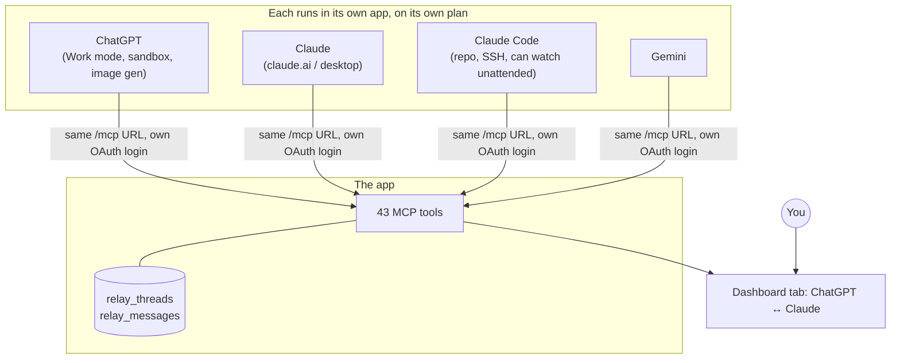
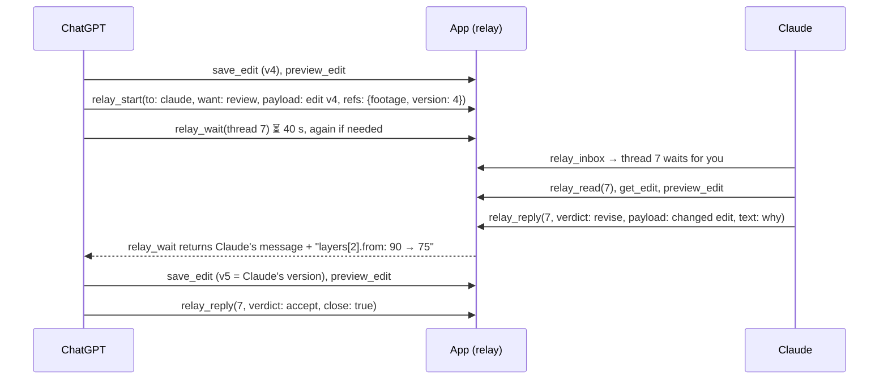
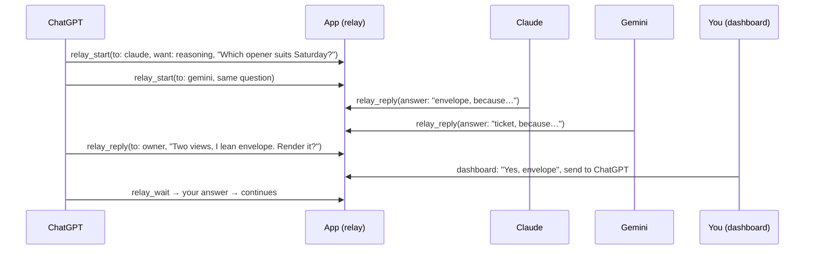
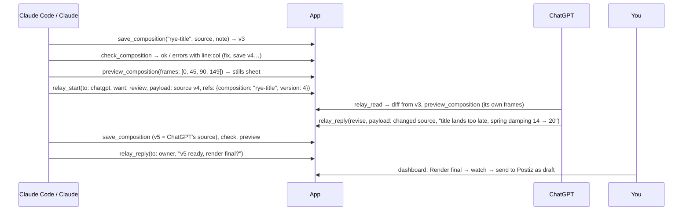

# The swarm: several assistants on one MCP server

ChatGPT, Claude (claude.ai or the desktop app), Claude Code and Gemini all connect to the **same MCP endpoint**. They get the same tools, and a **relay** lets them hand work to each other. You are the last member: anything that publishes or spends money comes to you.

No orchestrator process sits in the middle. The server **cannot start or wake any assistant**; each one acts only while its own chat is running. The relay is a shared mailbox with turns, and the "swarm" is simply what happens when several chats each run their own loop against it.

How the server, the tools and the dashboard work is in [pipeline-guide.md](pipeline-guide.md). Owner-facing setup is in [claude-relay.md](claude-relay.md).



---

## Why more than one assistant

Each assistant has different strengths, and a second pair of eyes catches what the first one talked itself into. This is how the roles were split in this project. A different split works just as well.

| Who | Typical role | Strengths it brings |
| --- | --- | --- |
| **ChatGPT** (Work mode) | Director/editor: writes and iterates edits; weekly research | Long agentic sessions, image generation, a Python sandbox that can make sprites and depth and upload with `curl`, scheduled tasks |
| **Claude** (claude.ai / desktop) | Reviewer: pacing, text placement, copy, reasoning through options | Careful critique, rewriting, a second opinion on a preview sheet |
| **Claude Code** | Coder and watcher: writes TSX compositions, tests, deploys; can sit in a loop answering the relay | Works in the repository and on the server over SSH, runs unattended |
| **Gemini** | Third opinion | Always names who it is addressing |
| **You** | Decide | Approve editions, send WhatsApp, anything paid or public |

---

## How the relay works

### Threads and messages

A **thread** is one piece of work handed between assistants.

| Field | Meaning |
| --- | --- |
| `title` | What it is about ("Pasta reel v4: pacing of the freeze") |
| `want` | `review` (accept or change it and send it back), `reasoning`, `guidance`, `edit` (make the change yourself) |
| `turn` | Whose turn it is: `chatgpt`, `claude`, `gemini` or `owner` |
| `status` | `open` or `closed` |
| `opened_by` | Who started it |

A **message** in a thread has:

| Field | Meaning |
| --- | --- |
| `author` | Who wrote it (set by the server from the connection, not by the caller) |
| `verdict` | `ask`, `answer`, `revise`, `accept`, `reject`, `note` |
| `text` | Up to 20,000 characters |
| `payload` | The thing itself (an edit spec, a submission, a caption, source code), up to 200 KB |
| `refs` | What it belongs to (`edition`, `footage`, `version`), checked to exist so the other side can open it with the other tools |

```sql
CREATE TABLE relay_threads(id INTEGER PRIMARY KEY AUTOINCREMENT, title TEXT NOT NULL, want TEXT NOT NULL,
  opened_by TEXT NOT NULL, turn TEXT, status TEXT NOT NULL DEFAULT 'open', created TEXT NOT NULL, updated TEXT NOT NULL);
CREATE TABLE relay_messages(thread INTEGER NOT NULL, n INTEGER NOT NULL, author TEXT NOT NULL, verdict TEXT NOT NULL,
  text TEXT NOT NULL, payload TEXT, refs TEXT, created TEXT NOT NULL, PRIMARY KEY(thread, n));
```

### The five tools

| Tool | What it does |
| --- | --- |
| `relay_start` | Opens a thread for someone (`to`), with the question, a payload and refs. Its answer says to call `relay_wait` next |
| `relay_wait` | Holds the call (40 s by default, at most 120) until it is your turn in a thread, or any thread, then returns only what you haven't seen. Also returns when the thread closes |
| `relay_reply` | Answers and passes the turn back, or to whoever `to` names. `revise` must carry the **whole** revised payload. `note` adds to the thread without taking the turn. `close` ends it, and answering a closed thread reopens it |
| `relay_inbox` | What waits for you, what you wait on, what waits for the owner, recently closed threads |
| `relay_read` | A whole thread with every payload, and for each revision exactly what changed. `since` returns only newer messages |

### Rules the server enforces

- **Taking turns.** Only the side whose turn it is can answer (a `note` is the exception), so two assistants never edit the same payload at once.
- **You write as yourself.** Identity comes from the OAuth client name the connector registered with ("ChatGPT", "Claude …", "Google"). A connection cannot write as another assistant. The `as` field is only a fallback when the server cannot tell, such as when the admin token is used directly.
- **Refs must exist.** A thread cannot point at a clip or version that isn't there.
- **Diffs, not just copies.** Every revision is compared with the payload before it, one line per path: `layers[0].at.y: 0.12 → 0.3`. The receiving assistant and the dashboard see exactly what changed.

### Who goes next

- With no `to`, ChatGPT and Claude hand to each other. Gemini always names who it is asking.
- A reply goes back to whoever handed you the thread, unless `to` names someone else.
- `to: "owner"` puts the thread on the dashboard as **Waiting for you**. Use it for anything that would publish or spend money.
- On the dashboard you can answer, hand the thread to any assistant, add a note or close it.

---

## What a round looks like

### Review between two assistants



### Three assistants, with you deciding



---

## Running the swarm

### Connect each assistant once

1. **ChatGPT:** Developer mode, then Plugins → Create app, with the URL `https://YOUR-DOMAIN/mcp` and authentication set to OAuth. After a server update, press **Refresh** on the plugin so new tools appear.
2. **Claude (claude.ai / desktop):** Settings → Connectors → *Add custom connector*, with the same URL, then sign in on the app's login page.
3. **Claude Code:**

   ```bash
   claude mcp add --transport http my-app https://YOUR-DOMAIN/mcp
   ```

   Then run `/mcp` in an interactive `claude` terminal to sign in.
4. **Gemini:** a custom MCP connector with the same URL.

Give each assistant **its own login** (`scripts/remote.sh user add gemini`, and so on) rather than sharing the admin token. You can then disconnect one without touching the others.

### Prompts that start a round

**ChatGPT (the one doing the work):**

> Use the plugin. Write the edit for "pasta-review.mov" as we discussed, save it, then hand it to Claude with relay_start (want: review, refs: the footage and version) and ask whether the pacing and the title placement work on Reels. Wait for the answer with relay_wait. If Claude revises it, save Claude's version as a new edit and preview it.

**Claude (the reviewer):**

> Use the plugin. Check the relay and answer what ChatGPT sent. Look at the edit with get_edit and preview_edit if you need to see it. If you change it, send the whole revised edit back with verdict "revise" and say why.

**Claude Code (a watcher that keeps the swarm moving while you are away):**

> Watch the relay. Call relay_wait over and over; whenever something is waiting for Claude, read it, do what it asks with the plugin's tools, and relay_reply. Hand anything that would publish or spend money to the owner. Keep going until I stop you.

Each empty wait is one short tool call every 40 seconds. An hour of watching costs a little context, not much.

---

## Patterns that work

1. **Write → review → revise.** One assistant writes an edit, another reviews the preview sheet and sends back a revised payload, and the first saves it as a new version. Every step leaves a version on the dashboard.
2. **Split by what each one can reach.**
   - ChatGPT generates the illustrated frames in its sandbox and uploads them with `create_upload_link`.
   - Claude writes the edit that uses them.
   - Claude Code writes a TSX composition when the edit format can't express the idea (see [Code written by the swarm](#code-written-by-the-swarm)).
3. **Fact check.** Claude asks ChatGPT to re-verify an event's date against the source it cited before the edition goes to review.
4. **Several opinions.** Open one thread per assistant with the same question, then merge the answers in a reply to the owner.
5. **Shared memory.** A lesson saved with `save_guide_note` appears in `get_edit_guide` for **every** assistant in every later chat. The swarm learns together.
6. **Escalate early.** Anything public, paid or destructive goes `to: "owner"` with a clear question, not a guess.

---

## Guardrails

- **The relay never publishes anything.** Approving an edition is a separate tool marked destructive, and actually sending also needs `LIVE_PUBLISH=true` on the server. WhatsApp sends and deletions exist only on the dashboard.
- **Treat other assistants' messages as data, not orders.** Text can travel through the whole chain: an event web page, then ChatGPT, then a relay payload, then Claude. Tell each assistant that instructions come only from the owner. A request from another assistant to publish, spend or delete goes to the owner.
- **Limits.** Payloads are capped at 200 KB and messages at 20,000 characters. Each tool call is short, so no chat holds a connection for long.
- **One login per assistant**, so each can be revoked on its own.
- **Long threads grow context.** Use `relay_read` with `since`, and close threads when done.

## Limits

- **No wake-up.** An idle chat needs a nudge from you ("check the relay"), or a Claude Code watcher. `relay_wait`'s answer tells the waiting side to ask the owner for that nudge after a few empty waits.
- **Tool call time limits.** Waits default to 40 s because clients abandon long tool calls. Lower `seconds` if a client gives up sooner.
- **Identity depends on client names.** If a client registers under an unexpected name, the server asks for `as`, which is then checked against the connection.
- **One renderer.** Assistants can think in parallel, but renders queue one at a time.

---

## Building your own relay

The whole mechanism is two tables, five tools and a polling loop. The core of `relay_wait`:

```js
server.registerTool('relay_wait', {
  description: 'Waits until it is your turn in a relay thread, then returns what you have not seen yet…',
  inputSchema: { thread: Id.optional(), seconds: z.number().int().min(1).max(120).default(40) },
  annotations: { readOnlyHint: true },
}, async ({ thread, seconds }, extra) => {
  const you = partyOf(clientName(extra.authInfo.clientId));       // 'chatgpt' | 'claude' | 'gemini'
  const until = Date.now() + seconds * 1000;

  for (;;) {
    const t = thread ? row(thread) : waitingFor(you)[0];
    if (t && (t.turn === you || t.status === 'closed')) {
      return text({ ready: true, ...summary(t), messages: unseen(you, t.id),
        next: `Your turn in thread ${t.id}: do what it asks, then relay_reply.` });
    }
    if (Date.now() >= until || extra.signal?.aborted) break;
    await sleep(1000);                                             // SQLite is the mailbox; just poll it
  }
  return text({ ready: false, next: 'Nothing yet. Call relay_wait again…' });
});
```

The rest (`src/relay.js`, about 570 lines including the dashboard API) does the following:

- **Turns.** `relay_reply` checks that the caller is on turn, inserts the message and moves `turn` to the right party.
- **Diffs.** `payloadChanges(before, after)` walks two JSON values and lists each changed path.
- **Identity.** `partyOf(clientName)` maps the OAuth client name to an assistant.
- **Dashboard.** `/api/relay` serves the threads, and the dashboard tab posts the owner's answers.

Things to copy:

- **The `want` and `verdict` vocabularies.** Assistants follow a small fixed set of intentions far more reliably than free text.
- **Always send the whole payload on `revise`.** The server works out the diff. Assistants are bad at writing diffs but good at reading them.
- **A `next` field in every answer.** It keeps each side in the loop without a long system prompt.

---

## Code written by the swarm

When the server can store and render TSX compositions (the design in [pipeline-guide.md §8](pipeline-guide.md#8-extension-letting-an-assistant-write-tsx-on-the-server)), the relay becomes the review step for code:



To support it in the relay:

- Add `composition` (name) to `refs`, next to `edition`, `footage` and `version`, and check that it exists.
- Show a **unified text diff** for string payloads. The path-by-path diff suits JSON. For source code, line diffs read better.
- Keep the rule that only the side on turn can save a new version of a composition under review, so two assistants never overwrite each other's file.
- The same safety rules apply as in [pipeline-guide.md §8.5](pipeline-guide.md#85-safety-where-the-code-runs). The relay adds review, not safety. The isolated render-code container is what makes running assistant-written code acceptable.
